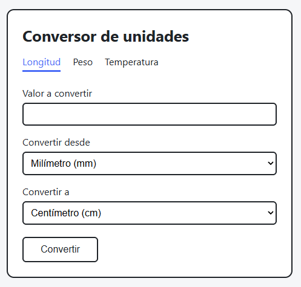

# Conversor de unidades (Unit Converter)

Aplicación web para convertir unidades de **longitud**, **peso** y **temperatura**.
El navegador envía el formulario al servidor, el servidor calcula la conversión y devuelve la página con el resultado.

Hecha solo con la librería estándar de Python (`http.server`, sin frameworks ni dependencias), como parte del
[proyecto Unit Converter de roadmap.sh](https://roadmap.sh/projects/unit-converter).

<p align="center">
  
</p>

## Requisitos

- Python 3 (probado con Python 3.15)

## Cómo usarla

```bash
python server.py
```

Luego abre **http://127.0.0.1:8000** en el navegador. Para detener el servidor, presiona Ctrl+C.

> En Git Bash para Windows, si Ctrl+C no detiene el servidor, arráncalo con `winpty python server.py`.

## Unidades disponibles

| Categoría | Unidades |
|---|---|
| Longitud | milímetro, centímetro, metro, kilómetro, pulgada, pie, yarda, milla |
| Peso | miligramo, gramo, kilogramo, onza, libra |
| Temperatura | Celsius, Fahrenheit, Kelvin |

El valor acepta punto o coma decimal (`1.5` o `1,5`).

## Rutas y códigos de estado

| Petición | Respuesta |
|---|---|
| `GET /` | `302` redirige a `/length` |
| `GET /length`, `/weight`, `/temperature` | `200` con el formulario |
| `POST` a esas mismas rutas | `200` con el resultado, o `400` con el formulario y el error |
| Formulario de más de 1 KB | `413` |
| Cualquier otra ruta | `404` |

Ejemplo con curl:

```bash
curl -i -d "value=20&from_unit=ft&to_unit=cm" http://127.0.0.1:8000/length
```

## Seguridad

- El servidor solo escucha en `127.0.0.1`, así que no es accesible desde otros equipos.
- Todo lo que escribe el usuario se escapa con `html.escape` antes de mostrarlo, para prevenir XSS.
- El tamaño del formulario está limitado, para no leer cuerpos arbitrariamente grandes.

## Tests

```bash
python -m unittest -v
```

- `test_converter.py`: conversiones, validación, formato de números y escape de HTML.
- `test_server.py`: levanta el servidor real en un puerto libre y le hace peticiones HTTP (GET, POST, 302, 400, 404 y 413).

## Estructura del proyecto

```
server.py             # Servidor HTTP: rutas, GET/POST, lectura del formulario y códigos de estado
views.py              # Genera el HTML: pestañas, formulario, resultado y página 404
converter.py          # Lógica: unidades, conversiones, validación y formato del resultado
templates/base.html   # Diseño común de todas las páginas
test_converter.py     # Tests de la lógica y del HTML
test_server.py        # Tests de integración del servidor
```

## Próximas funciones

- [ ] Volumen (mililitro, litro, galón, ...)
- [ ] Área (metro cuadrado, hectárea, acre, ...)
